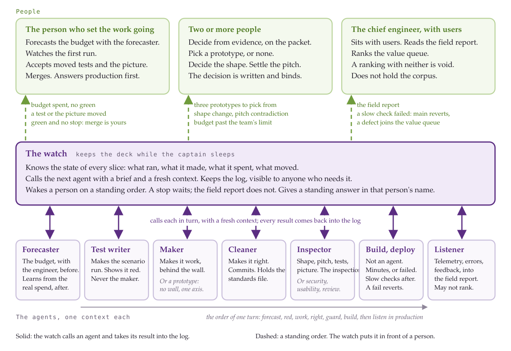

---
# GENERATED by xtreme-vibing/bin/publish-site.py from agents.md. Do not edit here.
layout: page.njk
title: "The agents"
description: "The seven kinds of agent in Xtreme Vibing, the watch that runs the pipeline, and how they work with people."
updated: "2026-11-09"
permalink: /agents/
nav: Agents
order: 4
---

# Xtreme Vibing: the agents

Section numbers point into the working notes behind these pages. The notes are not published.

Agents write the code. People decide. XV names seven kinds of agent. Each runs in its own context, with a brief for one job. None of them merges, ranks, or settles the shape. One of them, the watch, runs the pipeline: it calls the others in turn, keeps the record of what they did, and puts a decision in front of a person when a standing order says so. This page says what each agent does, what it may not do, and how the set works with people. The loop they run is [the loop](/loop/). The skills, scripts and CI examples that implement them are public, with the mechanics in the README: [github.com/seanpk/xv-agents](https://github.com/seanpk/xv-agents).

## Own the result

Even when the code is 100% written by agents, a person is 100% responsible for what it does. The agents are built around that.

An agent may write the tests, write all of the code, and deploy to production. It must stop, and hand the change to a person, when the change would:

- move the system away from its stated purpose, or widen it (the pitch);
- change the system's structure or its contracts (the shape, and the old tests on the wall);
- change what users experience without evidence from real use (Go and see).

The harness is built to hand back, not to approve. There is no agent that says yes. The watch wakes a person on its standing orders, and does in a person's name only what that person deputized it to do. The other stops in the loop, a spent budget, a stall, a check that cannot run, hand back too when the work itself goes wrong.

The other side of the rule is Ship at will. When the conditions are met, nobody else has to say yes either. The person who set the work going, the originator, merges and picks the moment.

## The watch

The watch is the agent that runs the pipeline. The name is from the bridge of a ship. The watch keeps the deck while the captain sleeps. It keeps the log. The picture is the team's: the watch changes it only when a person directs it. The captain leaves standing orders: wake me if this happens. The watch may wake the captain, and may not change course.

What it does:

- Knows the state of every slice. What ran, what it made, what it spent, what moved.
- Calls the next agent with a brief and a fresh context. The forecaster before the work. The test writer for red. The maker, the cleaner, and the inspector, one after another. The build. The field listener, in production.
- Keeps the log, and keeps it visible to the whole team while the slice runs. The log is one slice record per slice, with named fields: the scenario, who set the work going, the forecast, the wall baseline, moved tests and why, the cleaner's commit, the inspection report, the actual spend, each stop raised and who answered, the decision record. The home of the record is the team's: a file in the repo, a pull request, an issue.
- Wakes a person on a standing order, or gives a standing answer in that person's name. The orders are the stops in the loop ([the loop](/loop/), "Where the watch wakes a person"), and they are scripts, not prose, so a check can fail and CI can run it. A check that cannot run is not a pass; it is a stop. On a stop the watch writes the record, puts the question in front of the seat, and ends its turn with its context kept. The field report does not wait; the watch hands it over and goes on.
- Is started by a person, from their own session: "run this slice". A headless form runs the same steps where there is nobody to wait for, as in CI, and exits with the inspection report. The slice record carries the resume either way, so a slice can start at one desk and finish at another, or in CI.
- Records who took part in a decision, so the team knows who holds the context. Not for blame. (Section 6)
- Opens a pairing when the originator takes a step in hand, records who went and where the slice resumed, and closes it. It does not do the work. (Section 19)

What it never does: rank the value queue, settle a shape, edit the pitch, raise a budget, or edit its own standing orders. It merges only on a standing answer, and that is the person's merge, by the watch's hands. If it did any of these, it would be the approve button the method left out, or the product owner it dropped.

It does send a slice back, without a stop, when the inspector proves the slice misses its own scenario. The originator settled that when they accepted the scenario. The watch records why. The budget and a stall still stop it, and a finding outside the scenario goes to a person.

It also makes a change a person has already decided, word for word. At a stop, an option may show the exact edit, the old text and the new, such as a test rename or a changelog line. When the person picks it, the watch makes that edit in its own commit and names who directed it. It never words a change itself, and the edit changes no behavior. The suite runs again, and the inspection report gets a line for the edit. (Section 19)

The watch has standing orders for three seats:

| Seat | The watch wakes them for |
| --- | --- |
| The person who set the work going (the originator) | The budget is spent, green or not. A check cannot run. A stall: repeated failures or a diff that keeps growing, on this slice. An old test or the shared operating picture moved and the shape did not, or the inspector recommends a test join or leave the wall. The suite is green and nothing stopped: the merge is theirs. (Sections 1, 3, 5, 13, 15) |
| Two or more people | Three prototypes are ready to pick from, or none. A shape change, or a contradiction of the pitch. A budget past the limit the team agreed, or a shape change wider than the slice expected. (Sections 2, 3, 6, 13) |
| The chief engineer, with users | The field report. A slow check failed after the merge: the main line reverted on its own, and a defect joined the value queue. (Sections 9, 11) |

The standing orders say when to wake a person, and what the watch may answer without waking one. The second kind is a standing answer: it names a kind of stop and the answer the watch gives, in the name of the person who wrote it. One standing answer is "your pick": the watch decides that kind of stop itself. The merge may have a standing answer, for a bug of a kind the team names, and that is the person's merge, by the watch's hands. The watch records every stop it answered this way and names the standing answer. The person who wrote it owns the result and answers first when production raises its hand on a change merged under it.

A standing answer is written by whoever could answer that stop alone. The originator may write one for their own slice or for all their slices, in their own name, the merge included. A stop that takes two people takes two to answer in advance. The team's standing answers are the set every slice starts from; a developer's add to them; a slice's add to those. One enters only when a person writes it, from a retro that shows the same stop answered the same way, or from their own eye. The watch never writes or proposes one, and the retro counts how often each fires.

The right to a "your pick" answer is earned from the record, not claimed: the watch's pick on that kind of stop matched the person a set number of times in a row, and only blind matches count. While a kind of stop is being earned, the watch seals its pick in the record, shows the options in a shuffled order with none marked, and unseals after the person answers. A confidence number the model reports does not count. The record marks every stop the watch decided, so anyone can reopen it.

Three standing answers are in the core from day one. The forecast is the budget, and the slice starts on it with no stop unless the forecast is past the team's limit, far from the estimation guide's actuals for like slices, or the originator set another. A step that died on a usage or login limit runs again. A stop raised by a tool bug the team has named passes until the bug is fixed. A team may add the field listener's: which observations become an issue on the value queue with no person at it, and which become a fix that merges. Filing is not ranking.

No standing answer settles ranking, a shape, a pitch edit, a changed picture, a raised budget, or a change to a brief or a standing order. Those stop for a person. (Section 19)

## The agents, in the order of one turn

Each agent runs in its own context. It sees its brief, what the watch gives it, and what it pulls from the repo and the shared operating picture. It does not see the other agents' reasoning.

**The forecaster.** Before the work, it forecasts the budget for the slice with the engineer who will be responsible for it: tokens, time, and an expectation of shape change and its breadth. A human does not estimate tokens. The forecast goes into the slice record. The watch writes the actual spend into the same record as the work runs. When the slice closes, the forecaster appends one entry to the estimation guide: the slice, the forecast, the actual, the gap, one line on why. No acceptance before the write; it rides in the next inspection report, and anyone reverts. The guide is a list of closed slices and is never edited in place. The forecast prices rounds: how many passes through the agents it expects, with a send-back or a pairing as a cause in the guide. It may not raise a budget during the work. That is the engineer's call under Lead with conviction. (Sections 13, 19)

**The test writer.** It makes the scenario executable, as a Playwright trace or an API sequence, and shows it fail before the fix. It may mark tests that only prove this slice was done; those markings are part of the red the person who set the work going accepts. For a defect it starts from a recording. For a new feature it starts from words, and the first passing run is watched by a person, who adds the case they only noticed by seeing the wrong thing. When the person built to find out first, and kept the pick or the exploration, it gets the scenario and never that build: its red fails on the base, then runs against the build, and a failure there goes back to the maker. It is never the maker. A context that writes the red and then makes it green is agreeing with itself. In a pairing the originator may join it to get the red right; its context still never sees the build. (Sections 1, 19)

**The maker.** It makes it work, behind the test wall. Green means the new scenario plus every existing test. It may move an old test when the scenario forces it, and it records which assertion moved and why. An unrecorded change or deletion is the cheat. If the budget runs out without green, it stops. It does not renovate. With a prototype brief it builds one of three running versions that differ on one named axis, with no wall and a loose model; that context is never the one that builds the pick. When the pick, or an exploration, is kept, the maker takes it as the build and makes the red pass. On a refactor slice, which changes no behavior, it restructures and renames what the scenario names, and the existing suite is the red. In a pairing the originator may join it to get the solution right. (Sections 1, 2, 5, 13, 19)

**The cleaner.** It makes it right. In a separate context, it fixes structure and style against the standards file and commits the fix. It keeps changes to old tests as small as they can be, and it rejects a real test turned into a fake one. After green it removes the tests the test writer marked slice-only, with a record of the assertion and why. A structural change and a behavior change do not ride in the same pass. It holds the standards file: rules earned by repeated misses, applied without a person approving each fix. It never adds or removes a standard; a standard enters when the person who set the work going accepts it from the inspection report. A cleanup that would add an abstraction is not a cleanup. It is a shape proposal, and it goes to people. In a pairing the originator may call it on a piece in the middle of making, or join it to put the inspector's findings right. (Sections 1, 5, 14, 19)

**The inspector.** In a third context, with an adversarial brief, it checks for five things: a shape change, a contradiction of the pitch, any old test that changed, any new test that should join the wall or leave it, and what the change does to the shared operating picture. It draws the boundary diagram for the inspection report, because it did not build the change. It produces one inspection report for the proposed change, however many tests moved. A shape change or a pitch contradiction stops the change for two people. Changed tests, picture changes, and recommendations on which tests stay go to the person who set the work going. Agreement that does not cite evidence does not count. After a pairing or a send-back it runs again, fresh, with its own earlier report and the diff since, so the pass is short; which model runs it is the team's. Security and usability agents are inspector-kind agents with a different question. They give findings. None of them merge. (Sections 1, 3, 15, 19)

**Build and deploy.** Not an agent. The pre-merge suite returns in minutes, or the build has failed. After the merge, production is the default. Slow checks run after; a failure reverts the main line and raises a defect. Nobody stands on the deploy. (Sections 10, 11)

**The field listener.** In production, it gathers telemetry, errors, and the feedback users give, structured and unstructured, into the field report: complaints against the runs, paths no story describes, places the pitch and the behavior diverge. The chief engineer reads the field report and does not hold the corpus. The field listener may not rank from it. Where its field report starts a fix inside rules the team set, the two people who set the rules are the originator for every change that starts that way, and widening a rule takes two people. (Sections 9, 19)

## A pairing

A straightforward slice runs with the person at arm's length. A complex one does not. At any stop or send-back, the originator may take a step in hand, with the agent for that step: the test writer to get the red right, the maker to get the solution right, or the cleaner to put the inspector's findings right. They may call the cleaner on a piece in the middle of making. The order of the steps holds: the scenario, the maker, the cleaner, the inspector. The person assists a step; the step is still the step.

What holds in a pairing: the contexts stay apart, the test writer's context never sees the build, a test moves only with a record, and the inspector runs fresh after. If the scenario changed, it is amended and the red runs again, blind. If only the build changed, the cleaner and the inspector follow. Spend counts against the budget. The watch opens the pairing, records who went and where the slice resumed, and closes it. It does not do the work. (Section 19)

## Why the contexts stay separate

The three agents on one change are three contexts because each is a check on the one before. The maker wants green. The cleaner wants it clean and small. The inspector wants to find what the other two would rather not say. One context doing all three is one context grading its own work. The same reason keeps the test writer apart from the maker, and the prototype context apart from the context that builds the pick.

The team may run more agents, or more than one of each kind. The contexts stay separate.

## With people

People sit in three seats, and the watch knows which seat an order goes to.

The person who set the work going works with the forecaster before the slice, watches the first run of a new feature, accepts the red, moved tests, recommendations on which tests stay, and changes to the picture, merges when the suite is green and nothing stopped, and answers production first. They may take a step in hand by pairing with its agent. When they are away, any teammate may answer a stop in their place, or take the slice over with a record naming both and why; from then on the teammate is the originator. Taking a slice over only to merge is allowed. (Sections 1, 3, 6, 9, 12, 19)

Two or more people decide from evidence on the packet: which prototype, or none; the shape; a contradiction of the pitch. The decision is written down short, with who took part, and binds later agents. One person may answer a two-person stop provisionally, to keep the slice moving; a second person agrees before the merge, or reopens it. A team of one declares it: the same stops wait, one person answers, and the record says one person decided. (Sections 2, 3, 6, 7, 20)

The chief engineer sits with users and reads the field report, and ranks the value queue from both. A ranking with neither is void. (Sections 8, 9)

Nobody reads the code to accept a change. They read the inspection report: the scenario in words, the recording, the boundary diagram, what the suite asserts after the change, and the raw data when they want it. (Section 3)

An example from use. In xv-agents v0.3, [one slice record](https://github.com/seanpk/xv-agents/blob/v0.3.0/.xv/slices/2026-10-27-red-joins.md) and [its inspection report](https://github.com/seanpk/xv-agents/blob/v0.3.0/.xv/slices/2026-10-27-red-joins.packet.md) show a whole slice: the forecast, the budget a person set, red, green, a cleaner with nothing to fix, a inspector that found gaps, the person sending the work back twice, and the gap between forecast and spend at the close. One person decided it (section 20). The artifacts use the names of that version.

## Changing an agent

A change to an agent's brief, its may-not list, a standing order, or any check it is judged by is Decide from evidence by default: two people, written down short. A team may name cases where Lead with conviction is the better answer, and naming a case is itself a two-person decision. One learned rule inside the current brief is one person's call. An agent never accepts its own change.

What a team adds to shape the agents for its own system is the project layer: project-local, committed in the repo, shared by everyone on the project and every harness they use. It is add-only against the core: it may add a rule, a fact, an example, or a standing order, and it may not relax the contexts kept apart, the test writer is never the maker, the recorded move, the inspector's five checks, the stops, or the may-not lists. Each entry carries the miss it came from, and the entries are read before a burst and as it ends; one whose miss no longer happens without it is deleted. (Sections 16, 19)

## Left to the team

- The home of the slice record, and how a person is reached. A file in the repo, a pull request, an issue. The fields are fixed; the home is not.
- What a brief contains, beyond the scenario, the budget, and the parts of the shared operating picture that apply.
- How many of each kind to run, and which model runs which.
- The skills that implement the agents are [xv-agents](https://github.com/seanpk/xv-agents): skills any harness can read, scripts and CI examples for the mechanical parts, no agent-specific distribution. The first build was made from the plan of 2026-10-21 without use; each version after it is earned by use, and the current one is on the repo's [releases page](https://github.com/seanpk/xv-agents/releases). What a team adds is its project layer, and that stays in the team's repo.
