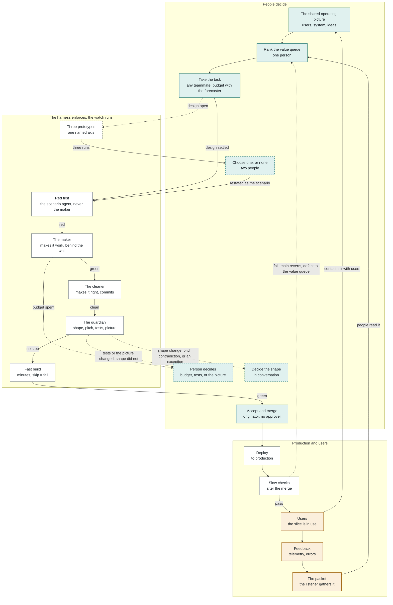

---
# GENERATED by xtreme-vibing/bin/publish-site.py from pipeline.md. Do not edit here.
layout: page.njk
title: "The delivery loop"
description: "One turn of the Xtreme Vibing loop: where agents build, where people decide, and where the harness hands back."
updated: "2026-10-21"
permalink: /loop/
nav: Loop
order: 3
mermaid: true
---

# Xtreme Vibing: the delivery loop

Section numbers point into the working notes behind these pages. The notes are not published.

Agents write the code. People rank the work, keep the pitch, sit with users, and decide the shape. The harness enforces the rest. The harness is the agents, the test suite, and the pipeline. The watch is the agent that runs the pipeline: it calls each agent in turn, keeps the log, and wakes a person on a standing order. It never decides. The agents are drawn in [the agents](/agents/). Nobody approves the merge, and work finishes in production.

## Before the work starts

- Mission and vision. Why we are here, and what the solution is becoming. Both exist before the work. They are preconditions, not values. The team is responsible for knowing them. The business's goals enter here and stop here. The business does not decide details. (Sections 8, 15)
- Users. We build for users. Value is their experience. It is the whole team's job. Anyone may refuse work that is not for their good. (Values; section 8)
- Evidence. We decide from real use. A ranking or shape decision with neither a recent session nor a packet from real use is void. That is Go and see: the real place is where the system is used. Two principles say how a person decides. Decide from evidence is two or more people on the packet; the decision is written and binds. Lead with conviction is the one-person case (value queue ranking, the change an engineer is making inside the current shape, changed tests, a changed picture); no record unless it makes a future job easier. (Values; Principles; sections 3, 9)
- The team holds four things:
  - The shared operating picture. The users, what the system is now, and ideas toward the vision. Written down, without repeating the code. Agents pull it when needed. Yesterday's change is part of it. (Section 15)
  - The pitch. One page in the repo: what, why, for whom. It changes when a second person agrees. (Section 7)
  - The shape. Coupling, what users meet, runtime budgets. It changes in conversation, never with a button. (Section 6)
  - The value queue. One person ranks it by customer value. Any teammate takes the next task. (Section 8)
- Outside the ranking:
  - Shareholder return. Set by the funders before the team existed. It does not rank work. A conflict with users is escalated out of the team. (Section 8)
  - Stakeholders and product owners. At best one user, more often a proxy. A meeting with them is not contact. (Section 9)

## Bursts

Work tends to come in bursts. A burst is a run of changes toward one direction the team has named. The shape conversation opens before a burst, to make the change easy, and as it ends, to ask what the burst left behind. Between bursts the team is with users. Nothing is built until the use has been observed. The loop below is one turn inside a burst. (Section 16)

## Observe, orient, decide, act

The loop is Boyd's OODA loop, simplified: four moves, and in each one both people and the harness have a part. The figure draws the four moves. The diagram under it draws the same loop by who acts, and the steps after that are the order of one turn.

| Move | People | The harness |
| --- | --- | --- |
| Observe | Sit with users. Contact is the act. | The listener gathers telemetry, monitoring, errors, and feedback into the packet. |
| Orient | Hold the shared operating picture, the pitch, and the shape. | Holds the test suite, what must stay true; the standards, what we have learned; and the watch's log, what was done. |
| Decide | Rank the value queue. State the scenario. Choose a prototype, or none. Decide the shape, in conversation. Decide from evidence and Lead with conviction say which of these takes two people and which takes one. | Enforces what a test or a standard settles. The watch stops and asks. It does not decide. |
| Act | Watch the first run. Accept and merge. No second approver. | The scenario agent shows red. The maker, the cleaner, the guardian. Build, deploy, revert. |

The factory is the Act move only (section 17). The constraint on the loop is steering, not build speed. The watch stops inside Act and wakes a person when the budget is spent, a test or the picture changed, or the shape or the pitch would change. That is Own the result: the harness may stop and may not decide.

## The loop

Green boxes are people. White boxes are the harness. Amber boxes are real use. A dashed box runs only when needed. A dashed arrow is a decision the watch hands back to a person, or the automatic revert.

The only gates on the way to production are machine gates: red before green, the test wall, the three agents, and a build that returns in minutes. People sit on the side paths, where a decision changes the pitch or the shape, or where tests or the picture moved and one person accepts it.

## The steps

**The watch** calls every harness step below, in turn, each agent in a fresh context, and takes the result into the log. Where a step says a person decides, the watch has woken them and is waiting.

1. Rank the value queue. People. One person ranks by customer value, so the product stays one product. A conflict between users and the people paying stops the ranking and leaves the team. (Section 8)
2. Take the next task. People and harness. Any teammate takes it. They know who it is for, and they may refuse it. The scenario is stated in words, with what this slice may ignore. A defect comes as a recording. **The forecaster** forecasts a budget with that person. (Sections 1, 8, 13)
3. Prototype, if the design is open. Harness and people. Only when the scenario does not settle the design, and a wrong design would be felt in use. Agents build three running versions that differ on one named axis. At least two people name which difference mattered, with a user when one can be reached. One is chosen, or none. The choice is restated as the scenario. The other runs are discarded. A prototype may run in production for a few real users when that is the only way to learn, and it is still discarded at the pick. (Sections 2, 9)
4. Red first. Harness. **The scenario agent**, never the maker, makes the scenario executable, as a Playwright trace or an API sequence, and shows it fails before the fix. (Section 1)
5. Make it work. Harness. **The maker** builds behind the wall. Green means the new scenario plus every existing test. The maker may move an old test when the scenario forces it, and records why. If the budget runs out without green, the work stops and a person decides. (Sections 1, 13)
6. Make it right, then guard. Harness. **The cleaner**, in a separate context, fixes structure and style against the standards file and commits the fix. It keeps changes to old tests small and rejects a real test turned fake. Structure and behavior do not ride in one pass. **The guardian**, in a third context, checks for a shape change, a pitch contradiction, a changed test, and what the change does to the shared operating picture. A shape change or pitch contradiction stops the change for two people. Changed tests and picture changes alone go in the packet to the person who set the work going, who may opt into a conversation. **Security and usability agents** give findings. None of them merge. (Sections 1, 3, 14)
7. Fast build. Harness. The merge waits on a suite that returns in minutes. A skipped or timed-out suite is a failed build. (Section 11)
8. Accept and merge. People. The person who set the work going watches the first run of a new feature and merges when the suite is green and the three agents find no break that requires a person. Any teammate may stand in. No second person approves. That is Ship at will. (Sections 6, 9)
9. Deploy to production. Harness. Production is the default, in slices small enough to revert. Slow checks run after the merge. If one fails, the pipeline reverts the main line and raises a new defect. The team takes the next task. Nobody stands on the deploy. (Sections 10, 11, 12)
10. Back to the shared operating picture. Real use and people. Telemetry, errors, and user feedback bring the change back. **The listener** gathers the packet. People read it and sit with users. A ranking or shape decision with neither a recent session nor a packet from real use is void. When production raises its hand, the person who set the work going answers first, and any teammate may answer in their place. (Sections 3, 9, 12)

## Where the watch wakes a person

The watch does not decide these. They are its standing orders. It stops and puts the decision in front of a person. That is Own the result: a person is responsible for every change, including one made entirely by agents.

| The watch sees | What happens | Section |
| --- | --- | --- |
| The budget is spent and the suite is not green | A person chooses to continue, reshape, or set it aside, under Lead with conviction. The value queue holder joins if the ranking changes. Past a limit the team agreed, or when the shape change is wider than expected, it goes to Decide from evidence. | 13 |
| Old tests or the picture changed and the shape did not | The packet lists them and goes to the person who set the work going. They talk it through with someone, or ship. A changed user message and its tests ship. | 1, 3, 15 |
| A cleanup would add an abstraction, or a change contradicts the pitch | The guardian produces the packet. It is a shape proposal, and people decide it in conversation. | 1, 3, 5, 6 |
| A coupled version meets a budget the clean one misses | People decide the exception from the two runs. The rule stays in the harness. | 4 |
| Repeated failures, or a diff that keeps growing | The shape conversation opens. The agent may not renovate. | 5 |
| A slow check fails after merge | No person. The main line reverts and a new defect enters the value queue. | 11 |

## Left out on purpose

- An approve button in front of the merge. (Section 6)
- Staging as the place work finishes, and release trains. (Section 10)
- A product owner seat standing in for users. (Section 9)
- People estimating tokens or hours. (Sections 8, 13)
- Weekly planning with a buffer. (Section 13)
- A long-lived branch for a big overhaul. It runs as two behaviors in the trunk. (Section 10)
- Coding standards on the maker or in `AGENTS.md`. (Section 14)
- An implementation plan reviewed by a person. The scenario is reviewed, and a spike is a prototype. (Sections 1, 2)

## Still open

From the open questions. Not part of the loop until agreed.

- How big a slice budget should be, and whether people need slack of their own.
- Whether a scenario in words is a strong enough red for a new feature.
- How to check a generated boundary picture against the run it shows.
