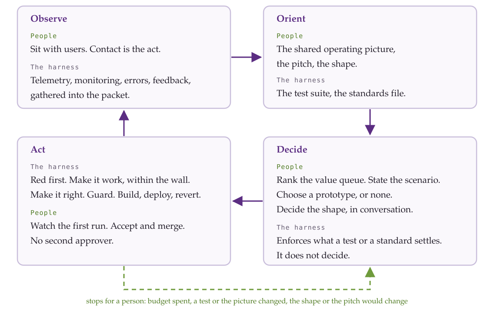
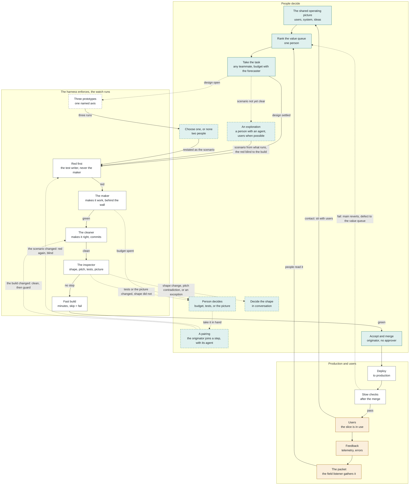

---
# GENERATED by xtreme-vibing/bin/publish-site.py from pipeline.md. Do not edit here.
layout: page.njk
title: "The delivery loop"
description: "One turn of the Xtreme Vibing loop: where agents build, where people decide, and where the harness hands back."
updated: "2026-11-09"
permalink: /loop/
nav: Loop
order: 3
mermaid: true
---

# Xtreme Vibing: the delivery loop

Section numbers point into the working notes behind these pages. The notes are not published.

Agents write the code. People rank the work, keep the pitch, sit with users, and decide the shape. The harness enforces the rest. The harness is the agents, the test suite, and the pipeline. The watch is the agent that runs the pipeline: it calls each agent in turn, keeps the log, and wakes a person on a standing order. What it does without waking one, it does on a standing answer, in that person's name. The agents are drawn in [the agents](/agents/). Nobody approves the merge, and work finishes in production.

## Before the work starts

- Mission and vision. Why we are here, and what the solution is becoming. Both exist before the work. They are preconditions, not values. The team is responsible for knowing them. The business's goals enter here and stop here. The business does not decide details. (Sections 8, 15)
- Users. We build for users. Value is their experience. It is the whole team's job. Anyone may refuse work that is not for their good. (Values; section 8)
- Evidence. We decide from real use. A ranking or shape decision with neither a recent session nor a field report from real use is void. That is Go and see: the real place is where the system is used. Two principles say how a person decides. Decide from evidence is two or more people on the packet; the decision is written and binds. Lead with conviction is the one-person case (value queue ranking, the change an engineer is making inside the current shape, changed tests, a changed picture); no record unless it makes a future job easier. (Values; Principles; sections 3, 9)
- The team holds four things:
  - The shared operating picture. The users, what the system is now, and ideas toward the vision. Written down, without repeating the code. Agents pull it when needed. Yesterday's change is part of it. (Section 15)
  - The pitch. One page in the repo: what, why, for whom. It changes when a second person agrees. (Section 7)
  - The shape. Coupling, what users meet, runtime budgets. It changes in conversation, never with a button. (Section 6)
  - The value queue. One person ranks it by customer value. Any teammate takes the next task. (Section 8)
- Outside the ranking:
  - Shareholder return. Set by the funders before the team existed. It does not rank work. A conflict with users is escalated out of the team. (Section 8)
  - Stakeholders and product owners. At best one user, more often a proxy. A meeting with them is not contact. (Section 9)

## Bursts

Work tends to come in bursts. A burst is a run of changes toward one direction the team has named. The shape conversation opens before a burst, to make the change easy, and as it ends, to ask what the burst left behind. Between bursts the team is with users. Nothing is built until the use has been observed. The loop below is one turn inside a burst. (Section 16)

## Observe, orient, decide, act

The loop is Boyd's OODA loop, simplified: four moves, and in each one both people and the harness have a part. The figure draws the four moves. The diagram under it draws the same loop by who acts, and the steps after that are the order of one turn.

| Move | People | The harness |
| --- | --- | --- |
| Observe | Sit with users. Contact is the act. | The field listener gathers telemetry, monitoring, errors, and feedback into the field report. |
| Orient | Hold the shared operating picture, the pitch, and the shape. | Holds the test suite, what must stay true; the standards, what we have learned; and the watch's log, what was done. |
| Decide | Rank the value queue. State the scenario. Choose a prototype, or none. Decide the shape, in conversation. Decide from evidence and Lead with conviction say which of these takes two people and which takes one. | Enforces what a test or a standard settles. The watch stops and asks. It does not decide. |
| Act | Watch the first run. Accept and merge. No second approver. | The test writer shows red. The maker, the cleaner, the inspector. Build, deploy, revert. |

The factory is the Act move only (section 17). The constraint on the loop is steering, not build speed. The watch stops inside Act and wakes a person when the budget is spent, a test or the picture changed, or the shape or the pitch would change. That is Own the result: even when agents write all of the code, a person is responsible for what it does, so the harness hands back, and does on its own only what a person deputized it to do.

## The loop

Green boxes are people. White boxes are the harness. Amber boxes are real use. A dashed box runs only when needed. A dashed arrow is a decision the watch hands back to a person, or the automatic revert.

The only gates on the way to production are machine gates: red before green, the test wall, the three agents, and a build that returns in minutes. People sit on the side paths, where a decision changes the pitch or the shape, or where tests or the picture moved and one person accepts it.

## The steps

**The watch** calls every harness step below, in turn, each agent in a fresh context, and takes the result into the log. Where a step says a person decides, the watch has woken them and is waiting.

1. Rank the value queue. People. One person ranks by customer value, so the product stays one product. A conflict between users and the people paying stops the ranking and leaves the team. (Section 8)
2. Take the next task. People and harness. Any teammate takes it. They know who it is for, and they may refuse it. The scenario is stated in words, with what this slice may ignore. A defect comes as a recording. **The forecaster** forecasts a budget with that person, and the forecast is the budget unless a check says it is far off. (Sections 1, 8, 13)
3. Build to find out, if we do not yet know what to build. Parallel prototypes, if the direction is uncertain and worth testing a few ways. Harness and people. Only when the scenario does not settle the design, and a wrong design would be felt in use. Agents build three running versions that differ on one named axis. At least two people name which difference mattered, with a user when one can be reached. One is chosen, or none. The choice is restated as the scenario. The pick may be kept as the build for the slice, or thrown away. The other runs are discarded. A prototype may run in production for a few real users when that is the only way to learn; at the pick, only the pick may stay, and only through a slice. (Sections 2, 9)
4. Or an exploration, if the scenario is not yet clear. People and an agent. A person gets creative with an agent and builds real code to experience, with real users trying it in the best case. When the behavior is right, the person writes the scenario from what runs. The slice and its budget start there. (Sections 1, 2)
5. Red first. Harness. **The test writer**, never the maker, makes the scenario executable, as a Playwright trace or an API sequence, and shows it fails before the fix. It may mark tests that only prove this slice was done. Those markings are part of the red the originator accepts. When a pick or an exploration is kept, it never sees that build: the red fails on the base, then runs against the build, and a failure there goes back to the maker as a miss against the scenario. A refactor slice changes no behavior and writes no new red: the existing suite, green at the start, is its red. (Sections 1, 19)
6. Make it work. Harness. **The maker** builds behind the wall, or takes the kept build and makes the red pass. Green means the new scenario plus every existing test. The maker may move an old test when the scenario forces it, and records why. If the budget runs out, green or not, the work stops and a person decides. (Sections 1, 13)
7. Make it right, then guard. Harness. **The cleaner**, in a separate context, fixes structure and style against the standards file and commits the fix. It keeps changes to old tests small and rejects a real test turned fake. After green it removes the tests marked slice-only, with a record. Structure and behavior do not ride in one pass. **The inspector**, in a third context, checks for a shape change, a pitch contradiction, a changed test, any new test that should join the wall or leave it, and what the change does to the shared operating picture. A shape change or pitch contradiction stops the change for two people. Changed tests, picture changes, and recommendations on which new tests stay go in the inspection report to the person who set the work going, who may opt into a conversation. **Security and usability agents** give findings. None of them merge. (Sections 1, 3, 14)

A pairing, at any of steps 5 to 7. People and an agent. At any stop or send-back the originator may take a step in hand, with the agent for that step: the test writer to get the red right, the maker to get the solution right, the cleaner to put the inspector's findings right, or the cleaner on a piece in the middle of making. The order of the steps holds. The test writer's context still never sees the build. If the scenario changed, it is amended and the red runs again, blind. If only the build changed, the cleaner and the inspector follow. The inspector runs fresh after every pairing, with its earlier report and the diff since. Spend counts against the budget. The record says who went, which step they joined, and where the slice resumed. (Sections 1, 5, 19)

8. Fast build. Harness. The merge waits on a suite that returns in minutes. A skipped or timed-out suite is a failed build. (Section 11)
9. Accept and merge. People. The person who set the work going, the originator, watches the first run of a new feature and merges when the suite is green and the three agents find no break that requires a person. Any teammate may stand in, or take the slice over with a record and merge as its originator. No second person approves. That is Ship at will. (Sections 6, 9, 19)
10. Deploy to production. Harness. Production is the default, in slices small enough to revert. Slow checks run after the merge. If one fails, the pipeline reverts the main line and raises a new defect. The team takes the next task. Nobody stands on the deploy. (Sections 10, 11, 12)
11. Back to the shared operating picture. Real use and people. Telemetry, errors, and user feedback bring the change back. **The field listener** gathers the field report. People read it and sit with users. A ranking or shape decision with neither a recent session nor a field report from real use is void. When production raises its hand, the person who set the work going answers first, and any teammate may answer in their place. Work that starts from the field report inside rules two people set has those two people as its originator. (Sections 3, 9, 12, 19)

## Where the watch wakes a person

The watch does not decide these. They are its standing orders. It stops and puts the decision in front of a person, or gives a standing answer in a person's name. That is Own the result: a person is responsible for every change, including one made entirely by agents.

| The watch sees | What happens | Section |
| --- | --- | --- |
| The budget is spent, green or not | A person chooses to continue, reshape, or set it aside, under Lead with conviction. The value queue holder joins if the ranking changes. Past a limit the team agreed, or when the shape change is wider than expected, it goes to Decide from evidence. | 13 |
| Old tests or the picture changed and the shape did not, or the inspector recommends a test join or leave the wall | The inspection report lists them and goes to the person who set the work going. They talk it through with someone, or ship. A changed user message and its tests ship. | 1, 3, 15 |
| A cleanup would add an abstraction, or a change contradicts the pitch | The inspector produces the inspection report. It is a shape proposal, and people decide it in conversation. | 1, 3, 5, 6 |
| A coupled version meets a budget the clean one misses | People decide the exception from the two runs. The rule stays in the harness. | 4 |
| Repeated failures, or a diff that keeps growing | Stall on this slice. Goes to the originator. Does not automatically open the shape conversation. | 5 |
| A check cannot run, or its input is broken | A person looks. It is never counted as a pass. | 11 |
| A slow check fails after merge | No person. The main line reverts and a new defect enters the value queue. | 11 |

A miss against the slice's own scenario is not a stop. When the inspector proves the slice does not yet do what its scenario says, the watch sends it back to the step that missed and records why. The originator decided this when they accepted the scenario. The budget and a stall still stop it. A finding outside the scenario, or a fix that would change the scenario, is a stop. (Section 19)

An answer may be a pairing. The originator takes the step in hand with its agent, and the watch records it. The order of the steps holds, and the inspector runs fresh after. (Section 19)

An answer may be an exact edit. When a stop offers the old text and the new, and the person picks it, the watch makes that edit and names who directed it. It never words a change itself, and the edit changes no behavior. The suite and the standing orders run again, and the inspection report gets a line for the edit. (Section 19)

A stop may have a standing answer. The standing orders say when to wake a person and what the watch may answer without waking one. A standing answer names a kind of stop and the answer the watch gives, in the name of the person who wrote it; "your pick" lets the watch decide, once the record shows its pick matched the person enough times in a row with the pick hidden and the options shuffled. The merge may have a standing answer for a change of a named kind, and it is the person's merge by the watch's hands. The person who wrote it owns the result; the originator may write one for their own slices, and a two-person stop takes two. The record names the standing answer at every such stop. No standing answer settles a change to the pitch, the shape, or the picture. (Section 19)

A team of one runs the same stops. A stop for two people still waits; one person answers it, and the record says one person decided. (Section 20)

A slice is visible to the whole team while it runs. When the originator is away, any teammate may answer a stop in their place, or take the slice over with a record. A two-person stop may be answered provisionally by one person to keep the slice moving; a second person agrees before the merge. (Sections 12, 19)

## Left out on purpose

- An approve button in front of the merge. (Section 6)
- Staging as the place work finishes, and release trains. (Section 10)
- A product owner seat standing in for users. (Section 9)
- People estimating tokens or hours. (Sections 8, 13)
- Weekly planning with a buffer. (Section 13)
- A long-lived branch for a big overhaul. It runs as two behaviors in the trunk. (Section 10)
- Coding standards on the maker or in `AGENTS.md`. (Section 14)
- An implementation plan reviewed by a person. The scenario is reviewed, and a spike is building to find out. (Sections 1, 2)

## Still open

From the open questions. Not part of the loop until agreed.

- How big a slice budget should be, and whether people need slack of their own.
- Whether a scenario in words is a strong enough red for a new feature.
- How to check a generated boundary diagram against the run it shows.
